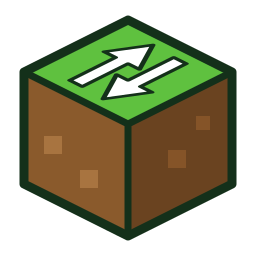
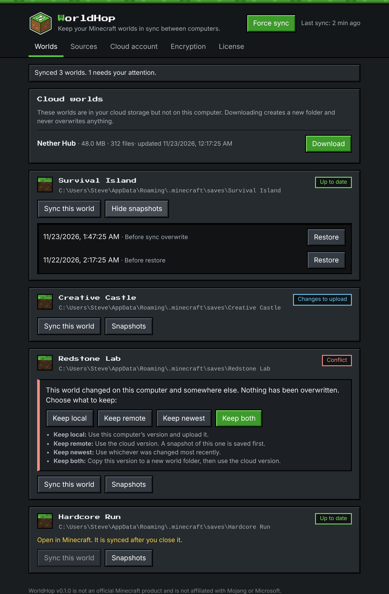
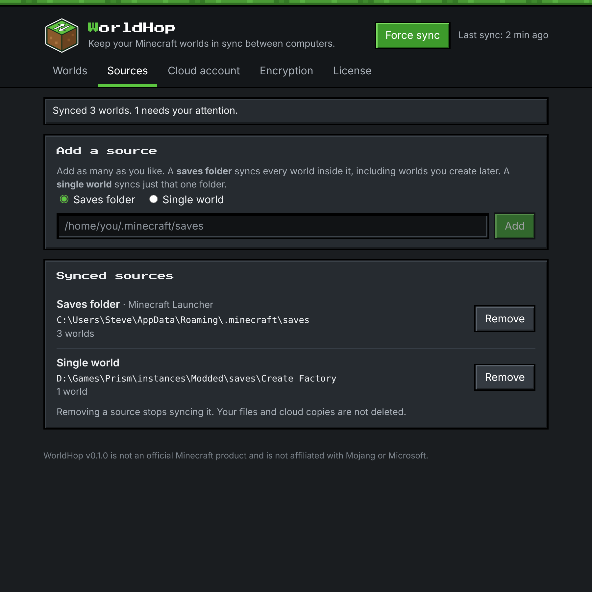
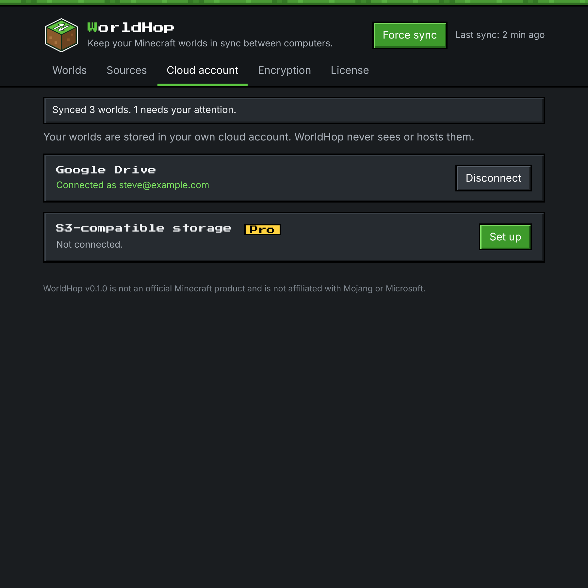
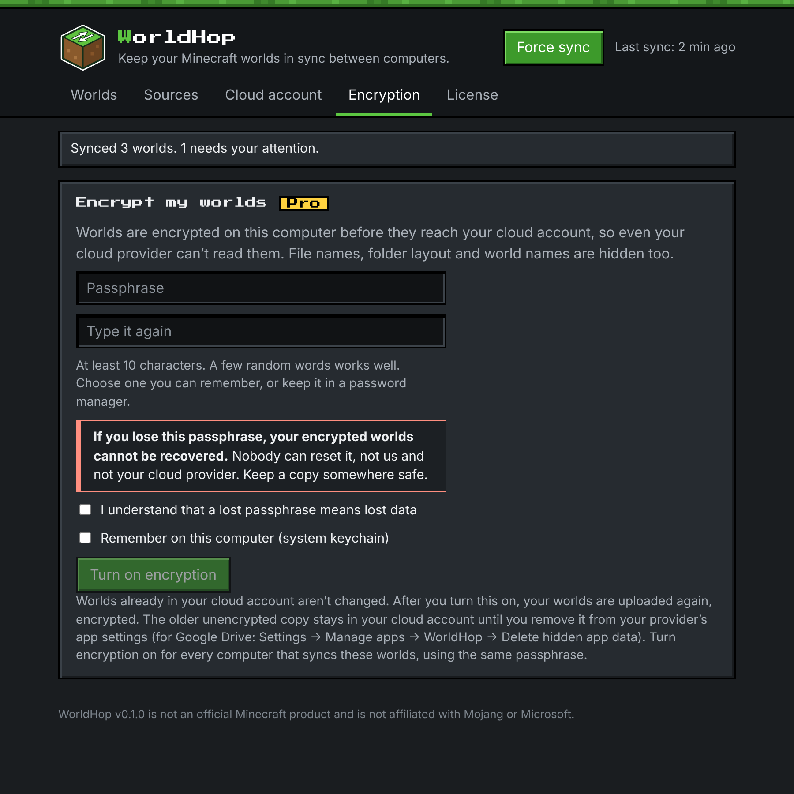

<p align="center">
  
</p>

<h1 align="center">WorldHop</h1>

<p align="center">
  <strong>Keep your Minecraft worlds in sync between all your computers.</strong><br>
  Start building on your desktop, pick up on your laptop. No more copying folders around.
</p>

<p align="center">
  
</p>

## What is WorldHop?

WorldHop is a small app that lives in your system tray (or menu bar on macOS). It notices when
Minecraft is closed and quietly syncs your worlds through **your own** cloud storage, so the world
you left on one computer is waiting for you on the next.

- **No account with us.** Your worlds go to your own Google Drive (or, with Pro, your own S3 bucket). There is no WorldHop server.
- **Safe by default.** WorldHop never syncs a world while Minecraft has it open, and it saves a snapshot before it overwrites anything, so you can always restore.
- **Works with your launcher.** Vanilla, Prism, MultiMC, CurseForge and Modrinth worlds, or any folder you point it at.
- **Stays out of your way.** There is no big desktop window. Click the tray icon and choose **Open Web View** when you want to look around.
- **Keeps a history, and tidies it.** Every upload is kept as a version in your cloud. Browse them and restore an older one, and WorldHop removes old versions on its own (you choose how many to keep, 5 by default).
- **Notices when your cloud loses something.** If the cloud deletes or rolls back a world, WorldHop stops and lets you choose, instead of quietly overwriting your newer copy.
- **Disconnecting really disconnects.** Disconnecting Google Drive revokes WorldHop's access at Google, not just on your computer.

## How it works

1. **Install WorldHop** on each computer you play on.
2. **Connect your cloud storage** with one click. A browser window asks you to sign in to Google and approve access. That's it, there are no config files to edit.
3. **Pick what to sync.** Add your whole Minecraft `saves` folder (new worlds are picked up automatically) or just a single world.
4. **Play.** When you close Minecraft, your changes are uploaded. On your other computer, WorldHop downloads them before you start.

The tray menu has three entries:

| Menu item | What it does |
|---|---|
| **Open Web View** | Opens the WorldHop window in your browser. |
| **Force Sync** | Syncs right now instead of waiting. |
| **Exit** | Quits WorldHop. |

If the same world was changed on two computers at once, WorldHop never guesses. It shows a **Conflict** and lets you choose: keep this computer's version, keep the cloud version, keep the newest, or keep both.

## Free vs Pro

**Get WorldHop Pro at [store.gugino.org](https://store.gugino.org).** It is a one-time purchase, with no subscription.

| | Free | Pro |
|---|---|---|
| Worlds synced | 1 | Unlimited |
| Google Drive storage | ✅ | ✅ |
| Your own S3-compatible bucket (AWS S3, Cloudflare R2, Backblaze B2, Wasabi, MinIO) | | ✅ |
| Client-side encryption (your cloud provider only sees scrambled data) | | ✅ |
| Snapshots and restore, on your computer and from your cloud's version history | ✅ | ✅ |
| Automatic cleanup of old cloud versions (you set how many to keep) | ✅ | ✅ |
| Detects cloud data that went missing or was rolled back | ✅ | ✅ |
| Conflict tools (keep this computer's, the cloud's, the newest, or both) | ✅ | ✅ |
| Change your encryption passphrase later, and remove the old unencrypted copy automatically | | ✅ |

Pro is a one-time purchase on Gumroad, from [store.gugino.org](https://store.gugino.org). After
buying you get a license key by email; paste it into the **License** tab in WorldHop. See [docs/licensing.md](docs/licensing.md) for the details,
including pricing and how license checks work.

## What's new in 0.2

- **Cloud version history.** Every upload is kept as a version. Open **Snapshots** on a world and use the **In the cloud** list to restore an older one (your current world is saved as a snapshot first).
- **Automatic cleanup.** Old versions and the data only they used are removed from your cloud about once a day, so storage stops growing. The **Settings** tab sets how many of the newest versions to keep (5 by default, 2 to 50), and anything from the last 14 days is always kept.
- **Protection from a misbehaving cloud.** If your provider deletes or rolls back a world, WorldHop stops syncing it and asks whether to use the cloud as it is now or upload this computer's copy. It never repairs anything on its own.
- **Revoke on disconnect.** Disconnecting Google Drive asks Google to end WorldHop's access. For S3, WorldHop tells you which access key to delete in your storage service, since it cannot cancel keys itself.
- **Encryption (Pro):** you can change your passphrase (everything is re-encrypted in the background), and the old unencrypted copy of a world is removed once its encrypted copy is in place.
- **S3 users:** the access key now needs delete permission (`s3:DeleteObject` on AWS) so old versions can be cleaned up.
- **Linux:** a `.deb` that adds WorldHop to your application menu, and a tarball that unpacks to `worldhop`.

See the [release notes](docs/release-notes/v0.2.0.md) for details.

## A look around

<table>
  <tr>
    <td width="50%"><br><sub><b>Saves:</b> sync a whole saves folder or a single world.</sub></td>
    <td width="50%"><br><sub><b>Cloud account:</b> connect Google Drive, or your own S3 bucket with Pro.</sub></td>
  </tr>
  <tr>
    <td width="50%"><br><sub><b>Encryption (Pro):</b> encrypted on your computer before upload.</sub></td>
    <td width="50%"></td>
  </tr>
</table>

## Getting started

1. Download the installer for your system from the [Releases](https://github.com/JGugino/world-hop/releases) page:
   - **Windows:** unzip `WorldHop-<version>-windows-amd64.zip` and run `worldhop.exe`.
   - **macOS:** open `WorldHop-<version>.dmg` and drag `WorldHop.app` out. It is not code-signed yet, so on first launch right-click it and choose **Open**. It lives in the menu bar.
   - **Linux:** install the `.deb` (`sudo apt install ./worldhop_<version>_amd64.deb`), or unpack the `.tar.gz` and run `worldhop`. The tray needs a desktop with AppIndicator support (on GNOME, the `gnome-shell-extension-appindicator` extension).
2. Click the WorldHop icon in your tray and choose **Open Web View**.
3. Go to **Cloud account** and click **Connect** on Google Drive.
4. Go to **Saves** and add your saves folder.
5. Repeat on your other computer. Worlds that are in the cloud but not on that computer show up under **Cloud worlds** with a **Download** button. Downloading creates a new folder and never overwrites anything.

> WorldHop is not an official Minecraft product and is not affiliated with Mojang or Microsoft.

---

## For developers

WorldHop is a Go binary (tray, sync engine, local web server) with a SvelteKit UI embedded into it.
The web server only runs while the web view is open.

Requires Go 1.24+, Node 22+ and pnpm.

```sh
cd ui && pnpm install && pnpm build     # builds the static UI into ui/build (embedded into the binary)
cd .. && go build -o worldhop ./cmd/worldhop
./worldhop              # tray icon + local UI on 127.0.0.1 (random port, logged at start)
./worldhop -no-tray     # API/UI only
```

- **Native window:** by default "Open Web View" opens your browser. For a native window build with
  `go build -tags webview ./cmd/worldhop` (needs cgo; webkit2gtk on Linux, WebView2 on Windows).
- **UI dev:** run the app with `-addr 127.0.0.1:47800` and `pnpm dev` in `ui/` (proxies `/api`).
- **Local folder store:** `-store <dir>` syncs to a plain folder instead of a cloud account, handy for testing.
- **Tests:** `go test -race ./...`

### Release builds

Release binaries have the app's Google OAuth client ID and the Gumroad product ID compiled in, so
end users never touch a config file.

```sh
make release GOOGLE_CLIENT_ID=... GUMROAD_PRODUCT_ID=...   # current OS
make release-linux                                          # dist/worldhop-linux-amd64
make release-windows                                        # dist/worldhop-windows-amd64.exe
make release-mac                                            # dist/worldhop-macos-{arm64,amd64} (Mac only)
make release-all                                            # Linux + Windows + macOS
```

Every binary is written to `dist/` (gitignored; override with `DIST=...`). The macOS build needs
cgo and Apple's SDK, so `release-mac` only runs on a Mac; `release-all` skips it with a warning
elsewhere.

Put the values in a gitignored `.env` next to the `makefile` and every release target picks them up.
Never commit real IDs. Pushing a `v*` tag runs the `release` workflow, which builds each OS and opens a draft GitHub release.

### Code layout

| Path | What's there |
|---|---|
| `cmd/worldhop` | The app: tray, web server, scheduler |
| `internal/worlds` | Finds worlds (vanilla, Prism, MultiMC, CurseForge, Modrinth, custom) |
| `internal/chunker`, `internal/manifest` | Content-defined chunking and the manifest format |
| `internal/store` | Storage interface; local folder, Google Drive and S3 backends |
| `internal/sync` | Push, pull, atomic swap, snapshots, conflicts, cloud versions and cleanup, lost-data detection |
| `internal/detect` | Detects whether Minecraft is running or a world is locked |
| `internal/crypt` | Client-side encryption, passphrase change, removing the unencrypted copy |
| `internal/license` | Gumroad license checks |
| `ui/` | SvelteKit web view |

### More docs

- [docs/cloud-setup.md](docs/cloud-setup.md): connecting cloud accounts, registering the Google OAuth app, S3 setup
- [docs/encryption.md](docs/encryption.md): how encryption works and what it protects
- [docs/licensing.md](docs/licensing.md): Free vs Pro, license checks, release setup, installers
- [docs/privacy.md](docs/privacy.md) and [docs/terms.md](docs/terms.md): Privacy Policy and Terms of Service

## License

The source is available under the [Functional Source License, Version 1.1, MIT Future License](LICENSE)
(FSL-1.1-MIT). You can read, build, modify and use it for your own purposes, including education,
research and contributing changes, but you may not offer it or a modified version as a competing
commercial product or service. Each release becomes available under the MIT license two years after
it is published. See the license text for the exact terms.
